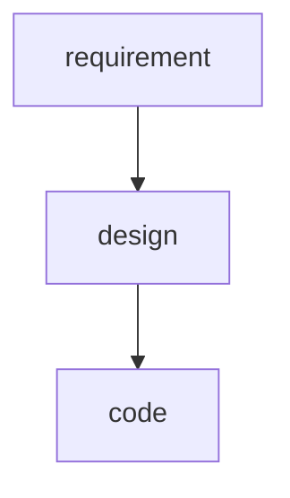

# Commands

```text
skein <command> [options]
```

Every command that works on a project finds it from the current directory: the nearest directory, here or above, that has a `.skein/`. `--root DIR` starts the search elsewhere.

| Exit status | Meaning |
| --- | --- |
| 0 | Done; the answer is on standard output. |
| 1 | The project has problems; they are on standard error, one per line, as `file:line:column: error: message`. |
| 2 | The command was not used as it must be, or there is no project. |

A command that reads other repositories (`check`, `trace`, `coverage`, `export`, `render`) reads each at the commit `.skein/network.toml` records. `--current` reads each at the commit its checkout has checked out, and `--working` reads its files as they are, committed or not. A repository given by its address is fetched into a cache; `--offline` fetches nothing and reads the cache. See [other repositories](repositories.md).

## `skein check`

Reads the configuration, the schema, every item and every citation, and reports everything that is wrong. With no problems it prints one line that counts what it read. This is the command for continuous integration.

What could not be checked, such as the items of another repository that is not at hand, is a warning: `file:line:column: warning: message`, shown with the problems. Warnings alone do not fail a check.

What it reports is listed in [writing items](writing-items.md) and [reviewing](reviewing.md).

## `skein trace ID`

Shows one item with everything around it:

```text
lex.comment  (rule, syntax, draft)
  spec/lex.md:4
  fingerprint 5f22a849198320cdad1f1067124515c1
  stage = s0

Links to:
  see lex.token (term)

Linked from:
  verifies c.comment (case)  [reviewed]
  verifies c.other (case)  [never reviewed]

Refers to: lex.token

Referred to by: c.comment

Mentioned in:
  spec/lex.md:2

Cited by:
  test  tests/comment.zig:1

Above (all it rests on): lex.token

Below (all that rests on it): c.comment, c.other
```

A link points up, from an item to what it rests on: a test to the rule it verifies, a requirement to the one it refines. So **above** an item is everything its links lead to, however many links away, and **below** it is everything that leads to it: what may need another look when the item changes.

`--json` gives the same as JSON: the item (with its text), and the IDs above and below.

## `skein coverage`

With test results, kept in the project or given with `--results FILE`, it also says per implementation which items passed, failed or are untested: see [test results](results.md). `skein trace ID` takes `--results` too. `--gitlab-requirements FILE` also writes GitLab's requirements report: see [forges](forge.md#gitlabs-requirements).

Counts, of the items that should be linked to or cited, how many are, and lists the ones that are not. An item with [parts](writing-items.md#parts-items-inside-an-item) also counts when every one of its parts does:

```text
Coverage of example

verifies links to rule items: 2 of 4 (50%)
  syntax: 2 of 2 (100%)
  legality: 0 of 2 (0%)
  without:
    lex.c
    lex.d

test citations of rule items: 2 of 4 (50%)
  syntax: 1 of 2 (50%)
  legality: 1 of 2 (50%)
  without:
    lex.b
    lex.c
```

What should be is what the project marks `expected = true`:

- a link type (`.skein/links/`): every item of its `to` types should be pointed to by a link of that type;
- a citation set (`[[citations]]` in `.skein/config.toml`): every item of its `to` types should be cited by the set.

Removed items are not counted. `--profile NAME` counts only the items of that profile (`.skein/profiles/`), for example one stage of a language or one software class. `--json` gives the counts and the lists as JSON. `--markdown` gives them as a Markdown table with the uncovered items folded away, for the summary of a CI job (`skein coverage --markdown >> "$GITHUB_STEP_SUMMARY"`) or a comment on a pull request.

Coverage reports; it does not fail. Its exit status is 0 whatever the numbers are.

## `skein diff [REV [REV]]`

Shows which items were added, removed or changed since a commit: by default the last one (`HEAD`), compared with the files as they are. `REV` is anything git takes for a commit: a hash, a tag, a branch, `HEAD~3`. With two, the first is compared with the second and the working tree is not looked at.

```text
Changes from v0.3 to the working tree

Added (1):
  lex.new  (rule)  spec/lex.md:13

Removed (1):
  lex.gone  (rule)

Changed (2):
  lex.token  (rule)  content  spec/lex.md:5
  lex.space  (rule)  status: approved -> deprecated, attributes  spec/lex.md:8
```

The **content** of an item has changed when its fingerprint is different, so a paragraph that was only rewrapped is not listed. A change to a part is also a change to the content of the item that contains it. A different status, links, attributes or verification method are each named. An item that was given the status of a removed item counts as removed.

## `skein impact [REV]`

The same changes, and what they reach in the project as it is now:

```text
Look again at (2):
  c.token  (case)  rests on lex.token  spec/lex.md:16
  c.deep  (case)  rests on lex.token  spec/lex.md:19

Links now suspect (1):
  c.token  verifies lex.token

Cited in (1):
  tests/token.zig:1  (test)  lex.token
```

- **Look again at:** every item below an item that was removed or whose content changed, however many links away, and every item whose text refers to it.
- **Links now suspect:** the reviewed links to those items; see [reviewing](reviewing.md).
- **Cited in:** the tests and code that cite them: the tests to run again, the code to read again.

Both commands take `--json`, and `--markdown` for a summary to put in a pull request. They need git: the earlier state of the project is taken out of the repository.

## `skein export [WHAT]`

Writes the project's graph to standard output, for other tools.

| `WHAT` | Gives |
| --- | --- |
| `json` (the default) | Everything as one JSON document: the item types and link types, and every item with its status, fingerprint, attributes, links both ways with their review state, references, approvals, citations and text. |
| `items` | CSV, one row per item: ID, type, category, status, verification, the item it is a part of, file, line, fingerprint, a column for each attribute, and the text. |
| `links` | CSV, one row per link: from, its type, the link type, to, its type, and the review state. A traceability matrix in its long form, ready for a pivot table. |
| `citations` | CSV, one row per citation: the citation set, file, line, the item and its type. |
| `gitlab-requirements` | CSV for GitLab's requirements import, `title,description`: see [forges](forge.md#gitlabs-requirements). |
| `reqif` | ReqIF 1.2, for DOORS and other requirements tools: a spec object per item (its ID, category, status, verification and attributes as strings, its text as XHTML, `ReqIF.Text`), a spec relation per link, and a specification per document with the items in order and their parts under them. Identifiers come from the IDs, so a later export updates the same objects; `LAST-CHANGE` is the time of the last commit of the item's file. |

`--profile NAME` exports only the items of that profile, with their links and citations.

The output is the same for the same project, byte for byte, so an export can be kept and compared. The JSON is what `skein trace --json` gives for one item, for all of them.

## `skein render --out DIR`

Writes the documents and item files of the project as Markdown for a site generator (Quartz, MkDocs, Jekyll, Hugo), into `DIR`, each under the path it has in the project. Use it as a step before the generator runs, and point the generator at `DIR`.

A source such as

```markdown
%rule[lex.comment syntax final] A comment is not a %[lex.token]; see %[lex.space white space].
```

is written as

```markdown
<a id="lex.comment"></a>**[lex.comment](#lex.comment)** *(syntax, final)* A comment is not a [lex.token](terms.md#lex.token); see [white space](#lex.space).
```

- **Markers** become an anchor and the ID, linked to itself, so every item can be linked to and its ID can be copied from the page.
- **References** become links to the item, in the same document or another, in items and in narrative text alike.
- **Item files** get YAML front matter with the ID as the title, which site generators read, in place of the TOML front matter.
- **Everything else** is written unchanged. Only Markdown files are written; images and other files stay where the generator already finds them.

The project itself is not changed. `DIR` is created when needed and is best kept out of git.

### `--format html`: the site itself

`skein render --format html --out DIR` writes a static site that needs no site generator: each document and item file as an HTML page, with its markers as anchors and its references as links, the images beside them, a front page that lists the pages, and a page of all items with what links to each and what refers to it.

Every link is relative and the styles are inside each page, so `DIR` can be served from any address (GitHub Pages, a file share) or opened straight from disk. The pages follow the reader's light or dark setting.

### `--editions`: each baseline beside the files as they are

With `--editions`, `skein render` also renders each baseline (see `skein baseline`) as it was, into `DIR/editions/NAME/`, in the same format, and writes `DIR/editions/index.md` (or `index.html`) listing them, newest first, after the files as they are now. Readers then pick the edition that matches a release. An edition shows no test results, which are of the files now; one that cannot be rendered (its configuration was not sound then) is said so and left out.

### Generated pages

A document can ask for a page that Skein makes from the project, in a fenced code block of the language `skein`. `skein render` replaces the block with the page, in both formats; elsewhere (on GitHub, in an editor) the request shows as the code it is.

````markdown
```skein
list term
```
````

| Request | Gives |
| --- | --- |
| `list [TYPE...] [category=C] [status=S] [profile=P] [ATTRIBUTE=V]` | A table of the items that pass every condition, with category, status and first paragraph. `list term` is a glossary. With `columns=criticality,verification`, those columns instead, as for a matrix. |
| `matrix LINKTYPE [conditions]` | Each item the link type may point to, with the items that link to it; the gaps marked **none**. A traceability matrix. With `columns=text,classes` and `from.columns=status,evidence`, those columns of the item and of each item linking to it, one row per linking item: a compliance matrix. |
| `coverage [profile=P]` | The coverage table, with links to the items that are not covered. |
| `documents` | The register of documents: each document that gives its identifier, with its title, revision and last change. |
| `history [type=TYPE]` | Measurements over time, for the measurement reports a standard asks for: at each baseline and now, the items of each type (or, with `type=`, of each status of that type) and the coverage of each expectation in percent, as Mermaid charts with a table of the numbers. A baseline is read from the files of its commit. |
| `burndown MILESTONE [weight] [from=DATE] [to=DATE]`, `burnup ...` | A milestone's burndown (what remains, beside a guideline to none) or burnup (scope and done), day by day up to today, from the project as committed each day; `weight` counts estimates in place of items. Work is done in the statuses of `[planning] done`, by default the type's last status. |
| `board [TYPE...] [conditions] [by=status\|assignee\|milestone]` | A board of the work items: a column for each status (or assignee, or milestone), a card for each item. |
| `time [TYPE...] [conditions]` | Time spent on work items against their estimates, in hours, with who spent it: see `skein time`. |
| `roadmap [MILESTONE...]` | The milestones by finish, each with its dates, how much of its work is done, and its work. |
| `gantt [TYPE...] [conditions] [by=parent\|assignee] [baseline=NAME]` | The schedule as a Gantt chart (a Mermaid diagram): bars, milestones and the critical path, by parent or by assignee, with a baseline's bars under today's to show slippage; and a table of the dates, slack and predecessors. See `skein schedule`. |

### Document control

A document that names itself in TOML front matter is controlled:

```markdown
+++
document = "EX-SDP"
revision = "B"
+++

# Development plan
```

Its rendered page gets, under its title, a table with its identifier, its revision, and when it last changed, by whom and in which commit (a link to the commit when the project names its forge), and at its end a change record: each baseline (`skein baseline`) in which its items changed, with the baseline's message and how many items were added, changed and removed since the one before. A rendered item file says in its front matter when it last changed, and by whom. All of it comes from git; without git, there is none.

A request Skein cannot read becomes a note in its place, saying what is wrong.

A document may also say what item it is and how mature it is, to be held to what that item expects at the project's milestone:

```markdown
+++
document = "SW-SDP"
revision = "B"
item = "PRD-01"
maturity = "B"
+++
```

```toml
# .skein/config.toml
[maturity]
order = ["D", "P", "B", "U", "F"]   # lowest first
milestone = "pdr"                   # the attribute of the items that says what is expected now
```

`skein check` then warns of a document below its item's value of `pdr` (the npr7150.2d template gives each product's expected maturity at each review), of one with no maturity, and of one naming an item there is not.

A milestone may also have a gate, as the handbook's review checklists set them (topic 7.09; the npr7150.2d template gives them):

```toml
[maturity.gates.pdr]
tbd = 1          # at most 1% of the requirements undecided
volatility = 20  # under 20% added, changed or removed since the last baseline
```

The items counted are those of the types with an undecided status, `tbd` or `tbr` (or the statuses `[maturity] tbd` lists), removed ones left out. `skein check` warns when the milestone's gate is not met, and `skein coverage` gives the numbers. The last baseline is the newest tag `skein baseline` made.

### Diagrams

A fenced block of the language `mermaid` is drawn as a diagram in HTML (`--format html` and `--format document`), by mermaid.js, which Skein carries (`vendor/mermaid`): the site has one copy of it, which only the pages with a diagram load, and a standalone document with a diagram has it inside (about 5 MB more). Markdown output leaves the block for the site generator.

````markdown

````

### `--format document`: one file per document

`skein render --format document --out DIR` writes each document as one HTML file that stands alone, for delivery: no navigation, its images inside it, and a style sheet for printing (or saving as PDF from a browser).

### `--profile NAME`: for one profile

With `--profile NAME`, in any format, only the items of that profile (`.skein/profiles/`) are rendered: for example one stage of a language, or one software class. An item outside it is left out with its parts, references to it become plain words, and generated pages list only the profile's items.

## `skein move OLD NEW`

Gives an item another ID, everywhere the old one is used, in one step:

```text
$ skein move lex.keywords lex.kw
skein: lex.keywords is now lex.kw, with 2 parts: 6 places in 3 files
```

- **What is rewritten:** the item's marker or front matter, every reference to it (`%[lex.keywords]`) in items and in narrative text, every link to it, and every citation of it in code, tests and `.skein-cites` files.
- **Parts follow:** a part whose ID continues the old ID is renamed with it (`lex.keywords.as` becomes `lex.kw.as`). A part with an ID of its own is left as it is.
- **Item files:** a file named after its ID (`SRS-012.md`) is renamed too.
- **Reviews and approvals survive:** a rename changes no content, so what was reviewed stays reviewed and what was approved stays approved, under the new IDs.
- **The old ID can stay as an alias:** with `--alias`, and by default in a project that declares an `id` (others may cite it), the old ID is written into the item's `aliases`, so a reference from another repository, an issue or a bookmark still finds the item; `check` warns there that the ID has changed. `--no-alias` leaves it out.
- **Only whole IDs on the lines that name them** are replaced. `lex.token` is not touched inside `lex.token.kinds`, nor in a line of code that merely contains the same letters.

`skein move` refuses, and changes nothing, when the new ID is taken or is not a valid ID of the item's type. Look at the result with `git diff` before committing; nothing is committed for you.

## `skein baseline [NAME]`

Freezes the project as it is committed, as a git tag: a version of a specification, a delivered set of requirements.

```text
$ skein baseline v1.0 --message "As delivered to review."
skein: baseline v1.0 at 3f2a91c; share it with: git push origin v1.0
$ skein diff v1.0
```

- The tag is annotated, and its message says what the project held: its number of items and its coverage.
- It is refused while there are uncommitted changes, or while `skein check` reports problems: a baseline is a state others can build on.
- `skein diff` and `skein impact` compare against a baseline like any commit: what changed since v1.0, and what it reaches.
- Without a name, `skein baseline` lists the baselines, oldest first. Ordinary tags are not listed.

The tag is only made locally; push it to share it.

## `skein pin [NAME [REV]]`

Records in `.skein/network.toml` the commit of each other repository that the items are checked against: the commit `REV`, or the one its checkout has checked out. With a name, only that repository is pinned. For a repository pinned before, it says what changed there and which of the changed items this project refers to, so that someone can look at them before committing the record. It refuses a checkout with changes that are not committed, unless the commit is named. It also records the repositories reached through the members' own records, and leaves submodules to git. See [other repositories](repositories.md).

## `skein import doorstop DIR...`

Turns Doorstop documents into Skein items, where they are; see [importing](importing.md).

## `skein import csv FILE --type TYPE --to DIR`

Makes an item file in `DIR` of each row of a CSV file; see [importing](importing.md).

## `skein import reqif FILE --type TYPE --to DIR`

Makes an item file in `DIR` of each spec object of a ReqIF file, as DOORS and other requirements tools write them; see [importing](importing.md#from-a-reqif-file).

## `skein gitlab-requirements [--profile NAME] [--dry-run]`

Keeps the GitLab requirements of the project (its forge is GitLab) to its items through GitLab's API: creates the missing ones, updates those that say otherwise, archives those of removed items, and keeps `.skein/gitlab-requirements.toml`; `--dry-run` says what it would do. See [forges](forge.md#gitlabs-requirements).

## `skein import gitlab-requirements FILE`

Records the GitLab requirement of each item, from the CSV GitLab exports of a project's requirements, in `.skein/gitlab-requirements.toml`; see [forges](forge.md#gitlabs-requirements).

## `skein review ID...` and `skein clear ID...`

Record that links have been reviewed; see [reviewing](reviewing.md). `review` takes the items whose links you looked at, `clear` the items that changed. `--all` takes every link.

## `skein approve ID...`

Records that someone approved these items as they are now; see [reviewing](reviewing.md). `--by NAME` says who (default: the name git has for the user), `--on DATE` when (default: today).

## `skein result ID pass|fail|skip`

Records a result that a person obtained, such as a procedure of a test plan carried out by hand, in the results the project keeps, with `--note TEXT`, `--implementation NAME`, `--by` and `--on` as for `approve`. It is stale once the item or what it links to changes; see [test results](results.md).

## `skein new TYPE [ID]`

Starts an item of a type.

```text
$ skein new srs
requirements/SRS-013.md
$ skein new rule lex.comment.block
%rule[lex.comment.block]
```

- **Numbered types** get the next free number when no ID is given: one more than the highest in use, counting removed items, so a number is never given twice.
- **Types with IDs joined by dots** need the ID, since only the author knows what it is about.
- **Where it goes:** a type with a source of item files gets its file there, with its front matter and no text, and the path is printed; `--to DIR` picks the source when there are several. A type written in documents gets its marker printed, to start a paragraph or list entry with.

`skein check` reports the new item as having no text until its text is written.

## `skein link FROM TYPE TO`

Adds a link of a type from one item to another:

```text
$ skein link c.one verifies lex.comment
skein: c.one verifies lex.comment
```

- **In a document**, the link goes in the item's marker: `%case[c.one verifies=lex.comment]`, or added to the values already there (`verifies=lex.token,lex.comment`).
- **In an item file**, it goes in the front matter: added to the key's list (`refines = ["SRS-001", "SRS-003"]`), or as a new key after the ID.
- **Refused**, with nothing written, is anything `skein check` would report: a link type the item cannot have, a target the link cannot point to, a removed target, a link to the item itself, or one that is there already.

## `skein examples --out DIR`

Writes each tested example (see [writing items](writing-items.md#tested-examples)) to a file of its own in `DIR`, named after its ID with its language's extension, and `examples.json`, which lists for each its ID, file, language, whether it must be accepted or rejected, the items it shows, where it is written, and the messages it must give (`messages`, empty unless the type names an `example.message`):

```json
[
  {
    "id": "lex.comment.open",
    "file": "lex.comment.open.csm",
    "language": "cesium",
    "expect": "reject",
    "shows": ["lex.comment"],
    "source": "spec/lex.md",
    "line": 9
  }
]
```

Skein runs none of them: the project's test driver reads the index, compiles or runs each file, and fails when an example is not accepted or rejected as it must be.

## `skein schedule`

Schedules the work items (item types with `[planning]`, see [project files](project-files.md#work-planning)) and writes the schedule to `.skein/schedule.toml`, and to the formats `[schedule] also` names. It says how many items it scheduled and how many are on the critical path, and writes `float` into float items that name no mode. Run it after a change to the plan, and commit what it writes: `skein check` reports a stored schedule that is not the one the items give.

## `skein overlay` and `skein apply`

A what-if plan is a branch whose deviations from what the forge holds are kept as an overlay, in `.skein/overlay.toml`: only the fields that differ, each with the upstream value it was based on. For work items that are issues (the planning role `issue`):

```sh
skein overlay '#12' assignees bob,carol   # in this plan, bob and carol do it
skein overlay '#12' milestone v2          # or "-" for none
skein overlay '#12' state closed
skein overlay                             # list the deviations
skein overlay '#12' state --remove        # the forge's again
```

The plan's schedule, charts and `skein load` see the issue with the overlay applied; everything else still comes from the forge. `skein check` reports a deviation whose upstream value has changed since. When the plan is adopted, `skein apply` writes the overlay to the forge (`gh`, signed in) and takes it out; a field that changed on both sides is left for a decision unless `--force`, and `--dry-run` writes nothing.

## `skein mirror`, `skein sync` and `skein publish`

`skein mirror` copies everything the forge holds of the project's repository (issues, pull and merge requests with their comments, milestones, labels) into plain text under `.skein/mirror/`, per checkout unless the configuration says `mirror = "committed"`. Offline, what the mirror says of an issue is what `check` and the views use. `skein sync` is the way back: it writes the overlay to the forge as `skein apply` does (`--dry-run`, `--force`) and refreshes the mirror. `skein publish --to KIND:OWNER/REPO [--url ADDRESS] [--dry-run]` re-creates the mirror on another forge, GitHub or GitLab, and records where each issue went in `.skein/forge-map.toml`. After a move, `skein rewrite-refs [--dry-run]` writes the new numbers into the references that were written with the old forge's (`[forge] formerly` names it). See [the forge](forge.md#a-full-mirror-working-offline-for-long-and-moving-between-forges).

## `skein time`

`skein time ITEM HOURS [--by NAME] [--on DATE] [--note TEXT]` logs time spent on a work item: by a person (default git's `user.name`) on a day (default today). It is kept in git under `.skein/time/`, one line per item, person and day, in the file of the item's document; logging the same day again adds to it. Without arguments, `skein time` sets what was spent against each work item's estimate (its estimate in days in the hours of the calendar's working day), with who spent it and the totals; `--json` gives the same as JSON. In a document, a `time [TYPE...] [conditions]` request gives it as a table.

## `skein load`

Each person of `.skein/resources.toml` with their work week by week (ISO weeks) and the hours they can work that week:

```text
ann (Ann Example)
  2027-W09  2027-03-01    64.0 h of  32.0 h  over by 32.0 h
  2027-W10  2027-03-08    24.0 h of  40.0 h
```

The work of an item is its estimate (else its duration) in days of the calendar's hours, spread evenly over its working days and shared evenly among its assignees. What a person can work is their share of the calendar's hours (or their hours a week) on their working days, less holidays and absences. Work without dates counts once it is scheduled. `--json` gives the same as JSON.

## `skein level [--write]`

Proposes moving work later so that nobody has more work in a week than hours to work, and lists the moves:

```text
t.a: 2027-03-08 to 2027-03-12, from 2027-03-01 (start = 2027-03-08)
t.c: 2027-03-15 to 2027-03-16, from 2027-03-08 (lag = 5)
skein: nothing written; --write writes these moves into the work items
```

The work is taken in the order of its start, critical work first; each item starts no earlier than its predecessors' new finishes, and on the first working day from which its hours, counted as `skein load` counts them, fit beside what its assignees have already. Finished work stays where it is. With `--write`, the moves go into the work items, to be reviewed as any change on a branch: fixed work gets its new start (and finish, when it gives one), float work that follows other work a longer lag, and float work that follows none a start (and the mode `fixed`, when it names `float`). Then `skein schedule` writes the new plan. Work that finds no room within two years is left where it is and listed.

## `skein lsp`

A language server for editors, on standard input and output. It works in the Markdown documents of a project and in the code and tests that cite its items.

- **Problems as you save:** what `skein check` reports is shown on the lines it concerns, in every file of the project, and updated whenever a file is saved.
- **Go to definition:** from the ID of an item to where it is declared, whether the ID stands in a reference (`%[lex.token]`), a link (`verifies=lex.token`), a citation in a test (`// spec: lex.token`) or plain text.
- **Find references:** every place that names an item: references, links and citations.
- **Hover:** the item's type, category and status, its text and its parts.
- **Completion:** item types after `%`, IDs in references and after a citation marker, and after the ID of a marker its categories, statuses, attributes and link types, then their values.
- **Rename:** renaming an item does what `skein move` does. Save your files first; the rename is made in them, and the editor shows them again.
- **Quick fixes:** a problem whose mending Skein knows is offered as a fix: the ID an item has now in place of a former one, and the closest ID, category, status, attribute, link type or verification method in place of a misspelled one.
- **Code lenses:** above each item, its links, those it has and those that point to it, and "Trace". The commands they run (`skein.pickLinked`, `skein.trace`) are the VS Code extension's; another editor shows them as text.
- **Skein's own requests**, for an editor's views: `skein/items` (every item with its place), `skein/itemAt` (the item under a position), `skein/trace` (`{ "id": ID }`, the item's trace as HTML), `skein/coverage` (the coverage page as HTML, with how much is covered), `skein/render` (`{ "uri": URI }`, the file as `skein render` writes it, for a Markdown preview), `skein/graph` (the network of items and links, with the review state of each link), `skein/form` and `skein/saveItem` (an item form, and writing it), `skein/schedule` (the work items as scheduled, with the calendar) and `skein/plan` (`{ "id": ID }` with a `start`, `finish` or `status` to write into the item). Their links are `skein:item/ID` and `skein:file/PATH#LINE`.

Any editor with a Language Server Protocol client can use it. Tell the editor to start `skein lsp` for Markdown files (and for the source files that hold citations) with the project's directory as the root. For example, in Neovim:

```lua
vim.lsp.config('skein', { cmd = { 'skein', 'lsp' }, filetypes = { 'markdown' }, root_markers = { '.skein' } })
vim.lsp.enable('skein')
```

and in Helix's `languages.toml`:

```toml
[language-server.skein]
command = "skein"
args = ["lsp"]

[[language]]
name = "markdown"
language-servers = ["skein"]
```

The VS Code extension starts the server itself, and adds the item tree, the trace and coverage views and the coverage in the status bar (`editors/vscode/readme.md`).

## `skein mcp`

A Model Context Protocol server for AI agents, on standard input and output, on the project it is started in (or `--root DIR`). Its tools are Skein's commands, answering in JSON: `items` (find items by type or words), `trace`, `check`, `coverage`, `impact`, and `new`, `link`, `move`, `result` and `approve`. An agent that speaks MCP is pointed at it with its own configuration, for example Claude Code's:

```sh
claude mcp add skein -- skein mcp
```

or a `.mcp.json` in the project:

```json
{ "mcpServers": { "skein": { "command": "skein", "args": ["mcp"] } } }
```

## `skein agents`

Writes what a coding agent should know of the project's Skein documents into its agent instructions: `AGENTS.md`, or `CLAUDE.md` where there is one and no `AGENTS.md`, or `--file PATH`. It says how markers and references are written, the project's item types, link types and citations, and to run `skein check` after editing. The section sits between two HTML comments, so running it again after a change to `.skein/` replaces it in place. `--skill` writes it as a skill file, `.claude/skills/skein/SKILL.md`, for agents that read skills. `skein init` writes the section too.

## `skein help`, `skein version`

The usage text, and Skein's version.

## In continuous integration

A CI job needs three lines: get Skein, check, and report coverage.

```yaml
# GitHub Actions
- name: skein
  run: |
    skein check --format github
    skein coverage --markdown >> "$GITHUB_STEP_SUMMARY"
```

- **`skein check` fails the job** when the project has problems (exit status 1). With `--format github` it writes each problem and warning as an annotation, which GitHub shows on its line in the pull request; without it, as `file:line:column: error: message`. The paths are from the project's root, so the project is to be at the root of the repository.
- **`skein coverage` never fails the job:** it reports. `--markdown` puts the table in the job's summary.

On GitLab, `--format gitlab` writes a Code Quality report, which the job keeps as an artifact so that GitLab shows the problems on the merge request:

```yaml
# GitLab CI
skein:
  script:
    - skein check --format gitlab > gl-code-quality-report.json
  artifacts:
    when: always
    reports:
      codequality: gl-code-quality-report.json
```

To get Skein in the job, download the archive of a [release](https://github.com/chasingdaylight/skein/releases) for the runner's platform and check it against the release's `SHA256SUMS`; pin the version, so that a new Skein never changes a job by itself.
