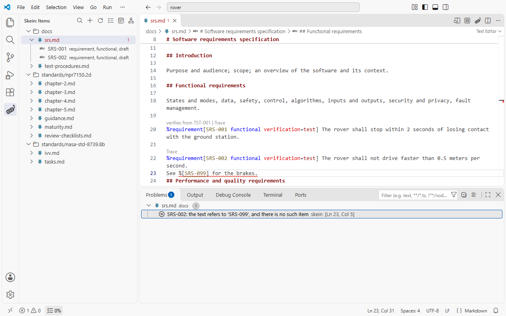
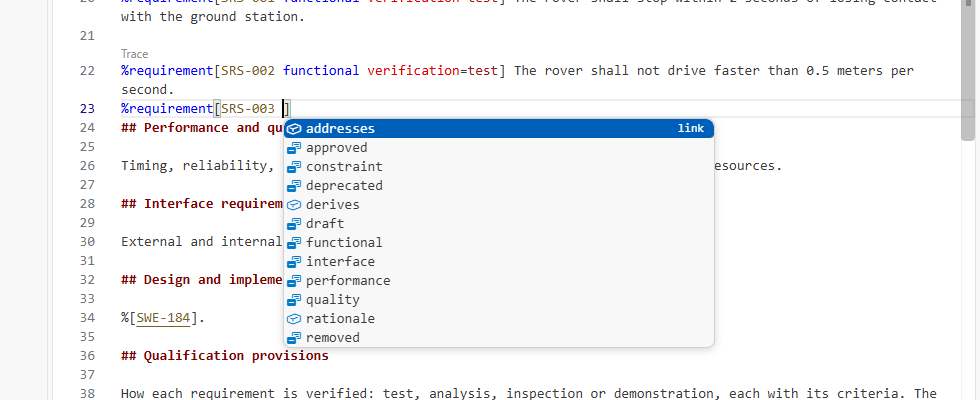
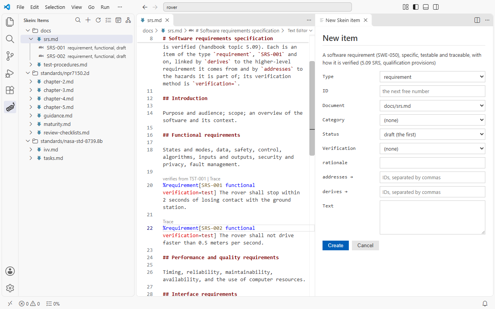
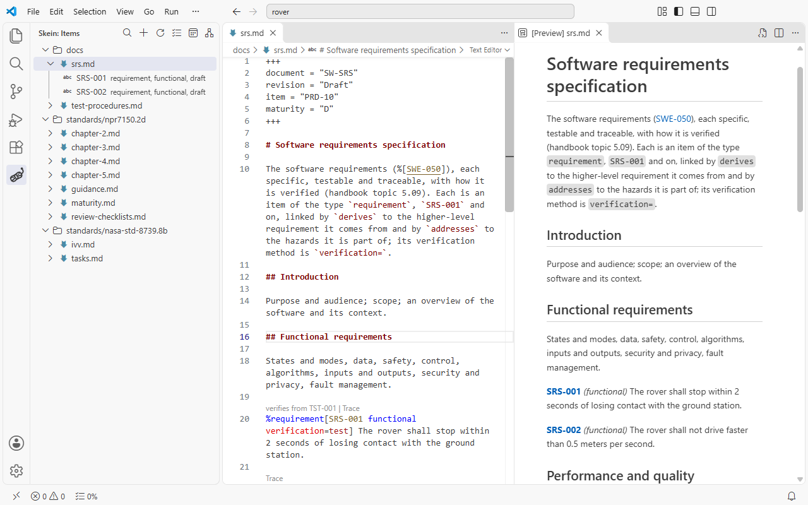
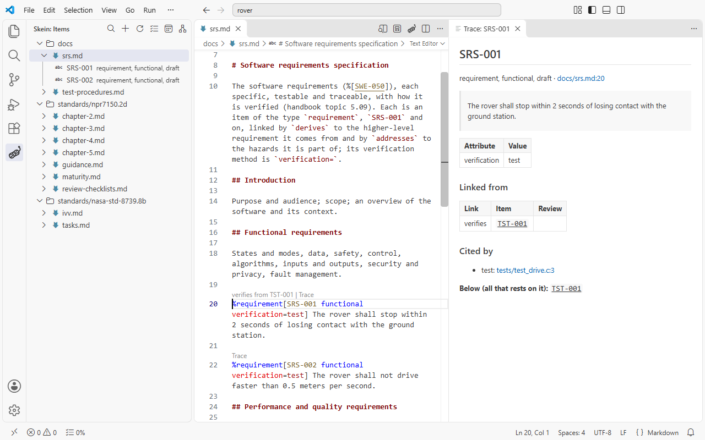
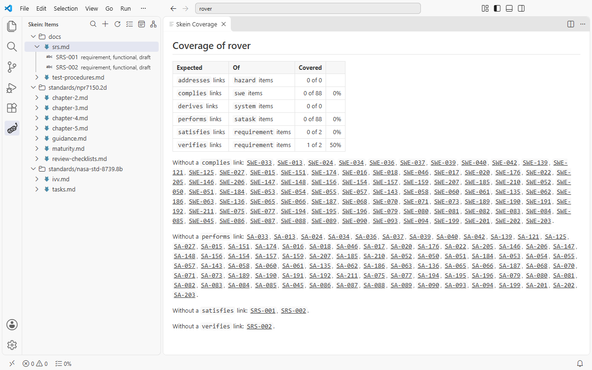

# Quickstart

From nothing to a checked project with a requirement, a test that cites it and a site of its documents, in about five minutes. The example is software under NASA's NPR 7150.2D, from Skein's `npr7150.2d` template; the same steps work for any [template](templates.md), or none. Every command was run as shown; your paths and fingerprints will differ.

Each step is shown on the command line, and then in VS Code (**In VS Code**), with the extension; use either, or both. [VS Code](vscode.md) has everything the extension does.

## 1. Get Skein

Download the package for your system from the [releases](https://github.com/chasingdaylight/skein/releases): `skein` is one program with nothing else to install. Put it on your `PATH`, then:

```text
$ skein version
0.2.0
```

**In VS Code:** install the extension **Skein** (`chasingdaylight.skein`) from the Extensions view. It brings the program with it, on the `PATH` of VS Code's terminals, so every command below also works there.

## 2. Start a project

In a git repository (here `rover`, a new one), name the template and the options you know:

```text
$ skein init --template npr7150.2d --option class=C
skein: a project in ., from the template npr7150.2d, with 29 documents to start from; 'skein check' checks it; AGENTS.md tells coding agents about Skein; .github/workflows/skein.yml checks them and collects them as PDFs
Still to do:
- Say where the tests and the code are (`[[citations]]` in `.skein/config.toml`, often there as comments to fill in), so that `skein coverage` counts what cites the requirements.
- Set `[maturity] milestone` to the review the project is at next, so that `skein check` holds the documents to the maturity it expects.
- Fill in the documents that are still the template's skeletons (29: docs/classification.md, docs/data-dictionary.md, docs/design.md, docs/estimates.md, docs/hazards.md, docs/index.md, ...), or remove those the project's tailoring leaves out.
```

What it wrote:

- `.skein/config.toml`: the project's name, the template with its options (`class = "C"`; the others at their defaults, each with what it means), and settings to fill in, commented out.
- `docs/`: a skeleton of each document the project delivers: the plans, the requirements, the design, the test documents, the Requirements Mapping Matrix. A class C project also gets NASA-STD-8739.8B's software assurance documents, with the safety-criticality determination, since NPR 7150.2D defers to that standard.
- `standards/`: the text of NPR 7150.2D and NASA-STD-8739.8B, which the documents refer to. Skein provides it; a `.gitignore` there keeps it out of git.
- `AGENTS.md`, for coding agents; `.github/workflows/skein.yml`, since the repository is on GitHub.

`skein template show npr7150.2d` lists the template's options: `safety-critical`, and `program`, `crewed` and `models-and-simulations`, which bring along the other NASA standards that apply. Give them with more `--option`s, or later in `.skein/config.toml`.

For a programming language's specification, `skein init --template langspec` starts one instead: a charter, a first chapter, a glossary and a coverage page.

**In VS Code:** open the repository's folder and run **Skein: Initialize a Project...** from the Command Palette (`Ctrl+Shift+P`), and choose `npr7150.2d` from the list of templates; it runs `skein init --template npr7150.2d` and shows what it wrote. To give options as you start, as `--option class=C` above, run the command in VS Code's terminal instead. The Skein icon then appears in the activity bar, and **Skein: Get Started** walks through what follows.

## 3. Check it

```text
$ skein check
skein: rover: no problems (848 items of 16 types, 11 link types, 2 profiles, 0 citations)
```

Most of those items are the standards' requirements, read-only. Run `skein check` after every change; it names the file and line of each problem.

**In VS Code:** there is nothing to run. Each time a file is saved, the Problems panel shows what `skein check` reports, on its line; here a reference to an item there is not:

<picture>
  <source media="(prefers-color-scheme: dark)" srcset="img/vscode/problems-dark.png">
  
</picture>

## 4. Write a requirement

Requirements are paragraphs of Markdown that start with a marker. In `docs/srs.md`, replace the example requirement with the project's:

```markdown
%requirement[SRS-001 functional verification=test] The rover shall stop within 2 seconds of losing contact with the ground station.

%requirement[SRS-002 functional verification=test] The rover shall not drive faster than 0.5 meters per second.
```

The rest of the document is narrative, which explains. [Writing items](writing-items.md) has everything a marker can say.

**In VS Code:** open `docs/srs.md` from the Skein view (the Skein icon in the activity bar) and type the markers: the editor completes the item types, categories, statuses and link types as you go.

<picture>
  <source media="(prefers-color-scheme: dark)" srcset="img/vscode/completion-dark.png">
  
</picture>

Or use the **Skein** menu on the editor's title bar, **New Item in This Document...**: a form of the requirement's fields, with the next free ID, which writes the marker for you.

<picture>
  <source media="(prefers-color-scheme: dark)" srcset="img/vscode/form-new-dark.png">
  
</picture>

Save, and **Open Preview to the Side** (the button at the top right of the editor) shows the document as Skein renders it, each requirement with its ID and category:

<picture>
  <source media="(prefers-color-scheme: dark)" srcset="img/vscode/preview-dark.png">
  
</picture>

## 5. Cite it from a test

Tests say which requirements they verify, in a comment. Uncomment the first `[[citations]]` in `.skein/config.toml`:

```toml
[[citations]]
name = "test"
path = "tests"
files = [".c"]
marker = "// verifies:"
to = ["requirement"]
```

And in `tests/test_drive.c`:

```c
// verifies: SRS-001
void test_stops_when_contact_is_lost(void) {
```

Now Skein knows what verifies the requirement:

```text
$ skein trace SRS-001
SRS-001  (requirement, functional, draft)
  docs/srs.md:20
  fingerprint 7318d7e16d19b275ab098e760a35e002
  verification = test

Linked from:
  verifies TST-001 (procedure)

Cited by:
  test  tests/test_drive.c:3

Below (all that rests on it): TST-001
```

(`TST-001` is the example procedure in `docs/test-procedures.md`, to replace in turn.)

**In VS Code:** above each requirement, a code lens lists its links (`verifies from TST-001`) and **Trace**, which opens the same trace beside the editor; its links open the items and the test.

<picture>
  <source media="(prefers-color-scheme: dark)" srcset="img/vscode/trace-dark.png">
  
</picture>

## 6. See what is missing

```text
$ skein coverage
Coverage of rover

addresses links to hazard items: 0 of 0

complies links to swe items: 0 of 88 (0%)
  without:
    SWE-033
    ...

satisfies links to requirement items: 0 of 2 (0%)
  functional: 0 of 2 (0%)
  without:
    ...

verifies links to requirement items: 1 of 2 (50%)
  functional: 1 of 2 (50%)
  without:
    ...

verified as their method requires:
  test: 0 of 2 (0%)
```

(The lists of items without a link are cut here.) A class C project accounts for 88 of the NPR's requirements in its mapping matrix, and its software assurance for as many tasks; `SRS-002` has no test yet, and no requirement has a passing test result. Each line is work to do, and `skein coverage` counts it down. [Test results](results.md) says how the results of a test run come in.

**In VS Code:** the status bar shows the share covered; **Show Coverage**, on the Items view's title bar or the **Skein** menu, opens the page, whose IDs open the items.

<picture>
  <source media="(prefers-color-scheme: dark)" srcset="img/vscode/coverage-dark.png">
  
</picture>

## 7. Publish it

```text
$ skein render --format html --out site
skein: 40 pages rendered to site
```

`site/index.html` opens in a browser: every document as a page, references as links, and a page of all items with what links to each. While you write, `skein serve` shows the same site at `http://127.0.0.1:8080/` and loads each page again as its files change. For delivery, `skein render --format document --controlled --out delivered` writes each controlled document as one HTML file named by its ID and revision (`SW-SRS-Draft.html`), ready to print as PDF.

Commit `.skein/`, `docs/`, `tests/`, `AGENTS.md` and `.github/`. On GitHub, the workflow `skein init` wrote checks the project on every push and pull request, and collects the documents as PDFs, with the coverage, in `engineering-docs.zip`, an artifact of each run.

## Where next

- [VS Code](vscode.md): every feature of the extension, and where to find it.
- [Tutorial: a new project under NPR 7150.2D](tutorial-npr7150.md): this project taken to its requirements review, step by step.
- [Examples](examples.md): the project that tutorial ends with, a language specification, and more, each rendered.
- [Tutorial: Skein in a project that has code](tutorial-existing-code.md): item types written by hand, for an existing program.
- [Tutorial: planning a project before the code](tutorial-planning.md): needs, requirements, work, a schedule and a board.
- [Templates](templates.md): every template, its options, and what NPR 7150.2D brings along.
- [Commands](commands.md): every command, and Skein in continuous integration.
