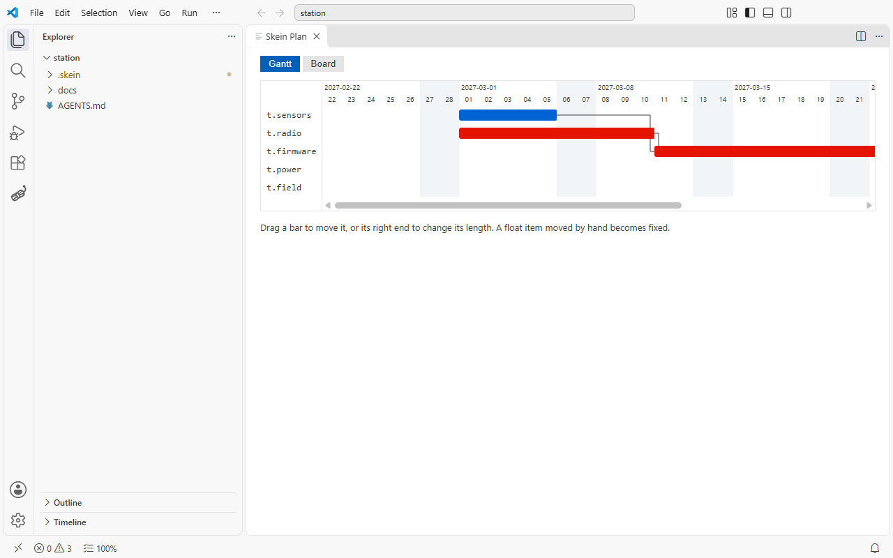
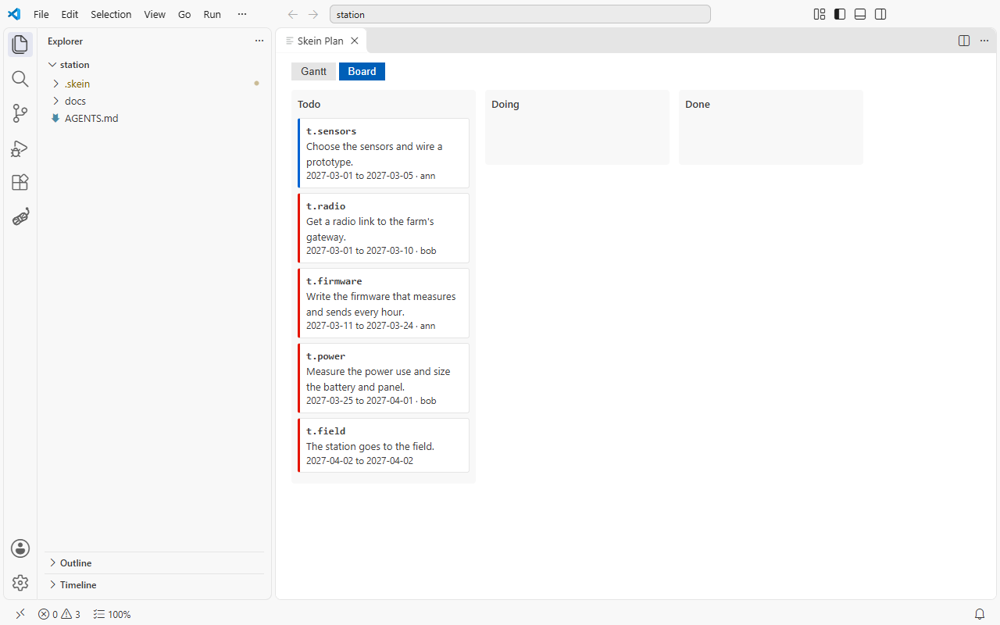

# Tutorial: planning a project before the code

This tutorial starts a project that has no code yet: a weather station for a farm. Skein holds what the farm needs, the requirements that answer it, and the work that will meet them, with who does it and when. By the end there is a schedule with its critical path, each person's load week by week, a Gantt chart and a board in a document, and a baseline of the plan as agreed. When the code starts, it cites the same requirements, as [the other tutorial](tutorial-existing-code.md) shows.

You need the `skein` program on your `PATH` (see [getting it](index.md#getting-it)) and git. Every command below was run as shown.

## 1. Start

In a new git repository:

```sh
git init station && cd station
skein init
```

The `.skein/config.toml` it writes gives the project's name, from its directory's, and where its documents are:

```toml
# the project's name, for reports
[project]
name = "station"

# where the items are: Markdown documents whose paragraphs can be items
[[sources]]
path = "docs"
```

## 2. Needs and requirements

Two kinds of items to start with: what someone needs, and the requirements that answer it. One file in `.skein/types/` declares each:

```toml
# .skein/types/need.toml
description = "What someone needs from the station"
id = "numbered"
prefix = "NEED"
```

```toml
# .skein/types/req.toml
description = "A requirement of the station"
id = "numbered"
prefix = "REQ"
```

A link type says how they relate. Every requirement must refine a need (`required`), and every need should be refined by some requirement (`expected`, which `skein coverage` counts):

```toml
# .skein/links/refines.toml
description = "A requirement refines a need"
from = ["req"]
to = ["need"]
required = true
expected = true
```

The items are paragraphs of Markdown documents, each starting with a marker. A link is written in the marker as `refines=NEED-001`:

```markdown
# Needs

%need[NEED-001] The farm needs to know the temperature and rainfall at the field, every hour.

%need[NEED-002] The station must run unattended for a season on its battery and solar panel.
```

```markdown
# Requirements

%req[REQ-001 refines=NEED-001] The station shall measure air temperature from -30 to 50 °C, to 0.5 °C.

%req[REQ-002 refines=NEED-001] The station shall measure rainfall in steps of 0.2 mm.

%req[REQ-003 refines=NEED-001] The station shall send its measurements every hour by radio.

%req[REQ-004 refines=NEED-002] The station shall run for 180 days without a visit.
```

```text
$ skein check
skein: station: no problems (6 items of 2 types, 1 link types, 0 profiles, 0 citations)

$ skein coverage
Coverage of station

refines links to need items: 2 of 2 (100%)

$ skein trace NEED-001
NEED-001  (need, draft)
  docs/needs.md:3
  fingerprint ead79985571581bc13ca9570f93e8865

Linked from:
  refines REQ-001 (req)
  refines REQ-002 (req)
  refines REQ-003 (req)

Below (all that rests on it): REQ-001, REQ-002, REQ-003
```

A requirement without `refines=` would be a problem for `skein check`; a need that nothing refines would show in `skein coverage`. Items start as `draft`; when they are agreed, `skein approve` records who approved them (see [reviewing](reviewing.md)).

## 3. Work

Work items are items too. A type with a `[planning]` table is work, and the table says which of the type's attributes holds each part of the plan: here when it starts, how many working days it takes, how many days of effort it needs, and who does it.

```toml
# .skein/types/task.toml
description = "Work to be done"
statuses = ["todo", "doing", "done"]

[attributes.start]
type = "date"
[attributes.days]
type = "integer"
[attributes.effort]
type = "integer"
[attributes.owner]
list = true

[planning]
start = "start"
duration = "days"
estimate = "effort"
assignees = "owner"
```

Two link types tie the work together. `after` orders it: this work starts once the work it names has finished. Its role, `follows`, is what makes it part of the schedule; a project that would rather write the order on the earlier work gives a link type the role `precedes` instead. `delivers` ties work to the requirements it meets, and is expected of every requirement, so that a requirement with no work planned for it shows in `skein coverage`:

```toml
# .skein/links/after.toml
description = "This work starts once the work it names has finished"
from = ["task"]
to = ["task"]

[planning]
role = "follows"
```

```toml
# .skein/links/delivers.toml
description = "The work delivers a requirement"
from = ["task"]
to = ["req"]
expected = true
```

## 4. People and the calendar

`.skein/resources.toml` lists the people work is assigned to, and the project's calendar. Days in the plan are working days: Monday to Friday unless the calendar says otherwise, less its holidays. Bob works half time:

```toml
# .skein/resources.toml
[calendar]
holidays = [2027-04-05]

[people.ann]
name = "Ann Example"

[people.bob]
name = "Bob Example"
share = 0.5
```

## 5. The plan

The plan is a document like the others. Its work items are list entries with markers, and two fenced blocks of the language `skein` ask for a Gantt chart and a board, which `skein render` draws in their place (on GitHub or in an editor they show as the requests they are):

````markdown
# Plan

## Work

- %task[t.sensors start=2027-03-01 days=5 owner=ann delivers=REQ-001,REQ-002] Choose the sensors and wire a prototype.
- %task[t.radio start=2027-03-01 days=8 owner=bob delivers=REQ-003] Get a radio link to the farm's gateway.
- %task[t.firmware days=10 owner=ann after=t.sensors,t.radio delivers=REQ-001,REQ-002,REQ-003] Write the firmware that measures and sends every hour.
- %task[t.power days=6 owner=bob after=t.firmware delivers=REQ-004] Measure the power use and size the battery and panel.
- %task[t.field days=0 after=t.firmware,t.power] The station goes to the field.

## Schedule

```skein
gantt
```

## Board

```skein
board by=assignee
```
````

The first two tasks have a start, so they are fixed to their dates. The others have none, so they float: each starts on the first working day after everything that precedes it has finished. `t.field` takes no days: it is a milestone.

## 6. Schedule it

```text
$ skein schedule
skein: 5 work items scheduled, 4 on the critical path; wrote .skein/schedule.toml
```

`.skein/schedule.toml` holds every work item's dates, its slack (how many working days it can slip without moving the end) and whether it is on the critical path. Skein writes it, the project commits it, and `skein check` reports when it is out of date with the items:

```toml
[items."t.sensors"]
start = 2027-03-01
finish = 2027-03-05
mode = "fixed"
source = "written"
slack = 3
critical = false
```

`skein check` also looks at the people:

```text
$ skein check
.skein/resources.toml: warning: bob: in the week of 2027-03-01 (2027-W09), 40.0 hours of work and 20.0 hours to work
.skein/resources.toml: warning: bob: in the week of 2027-03-08 (2027-W10), 24.0 hours of work and 20.0 hours to work
.skein/resources.toml: warning: bob: in the week of 2027-03-29 (2027-W13), 32.0 hours of work and 20.0 hours to work
skein: station: no problems, 3 warnings (11 items of 3 types, 3 link types, 0 profiles, 0 citations)

$ skein load
ann (Ann Example)
  2027-W09  2027-03-01    40.0 h of  40.0 h
  2027-W10  2027-03-08    16.0 h of  40.0 h
  2027-W11  2027-03-15    40.0 h of  40.0 h
  2027-W12  2027-03-22    24.0 h of  40.0 h

bob (Bob Example)
  2027-W09  2027-03-01    40.0 h of  20.0 h  over by 20.0 h
  2027-W10  2027-03-08    24.0 h of  20.0 h  over by 4.0 h
  2027-W12  2027-03-22    16.0 h of  20.0 h
  2027-W13  2027-03-29    32.0 h of  20.0 h  over by 12.0 h
```

Without an effort, a task's work is its whole length at full time: eight days of Bob's at eight hours a day, where he works four. The radio link and the power work need half their length of effort, so give them that: `effort=4` on `t.radio` and `effort=3` on `t.power`. Then schedule again:

```text
$ skein schedule
skein: 5 work items scheduled, 4 on the critical path; wrote .skein/schedule.toml

$ skein check
skein: station: no problems (11 items of 3 types, 3 link types, 0 profiles, 0 citations)

$ skein load
ann (Ann Example)
  2027-W09  2027-03-01    40.0 h of  40.0 h
  2027-W10  2027-03-08    16.0 h of  40.0 h
  2027-W11  2027-03-15    40.0 h of  40.0 h
  2027-W12  2027-03-22    24.0 h of  40.0 h

bob (Bob Example)
  2027-W09  2027-03-01    20.0 h of  20.0 h
  2027-W10  2027-03-08    12.0 h of  20.0 h
  2027-W12  2027-03-22     8.0 h of  20.0 h
  2027-W13  2027-03-29    16.0 h of  20.0 h
```

And every requirement has work that delivers it, and every need a requirement:

```text
$ skein coverage
Coverage of station

delivers links to req items: 4 of 4 (100%)

refines links to need items: 2 of 2 (100%)
```

## 7. See it, and agree on it

```text
$ skein render --format html --out site
skein: 5 pages rendered to site
```

`site/docs/plan.html` has the Gantt chart, with the critical path marked, the milestone and the holiday left out of the working days, and the board with a column for each person. `site/` is best kept out of git and built in CI (see [in continuous integration](commands.md#in-continuous-integration)). The same requests take other forms: `board` by status (`todo`, `doing`, `done`), `gantt by=assignee`, `roadmap`, and `burndown` and `burnup` of a milestone; see [generated pages](commands.md#generated-pages).

**In VS Code:** **Skein: Show Plan** (on the Items view's title bar, or the **Skein** menu) opens the same Gantt chart and a board by status. Dragging a bar moves a task, or by its right end changes its length; dragging a card to another column changes its status; each change is written into the task's marker and the schedule follows.

<picture>
  <source media="(prefers-color-scheme: dark)" srcset="img/vscode/plan-dark.png">
  
</picture>

<picture>
  <source media="(prefers-color-scheme: dark)" srcset="img/vscode/board-dark.png">
  
</picture>

When the plan is agreed, commit it and make it a baseline, which is an annotated git tag:

```text
$ git add -A && git commit -m "The station: needs, requirements and the plan"
$ skein baseline plan-1 --message "The plan as agreed."
skein: baseline plan-1 at 4626efe; share it with: git push origin plan-1
```

Later, `skein diff plan-1` lists what changed since, and `gantt baseline=plan-1` draws the agreed bars under today's, to show what slipped.

## 8. As the work goes on

- **Progress:** a task's status moves from `todo` to `doing` to `done` in its marker (`%task[t.sensors done ...]`), and the board by status shows it. In VS Code, the extension's **Skein: Show Plan** shows the Gantt chart and the board, and dragging a bar or a card writes the change into the item.
- **Code:** when the firmware starts, its code and tests cite the requirements they implement and verify, as in [the other tutorial](tutorial-existing-code.md), and `skein coverage` counts what is tested beside what is planned.
- **Issues:** work that is an issue on GitHub or GitLab can say so (`issue=#12`, with the planning role `issue`), and its assignees, milestone and state are then read from the forge rather than written twice: see [project files](project-files.md#work-planning) and [the forge](forge.md).
- **Time:** `skein time t.firmware 6` logs six hours spent on it, and `skein time` sets what was spent against each estimate.
- **Several repositories:** a planning repository can hold the people, the calendar and the schedule for the repositories of a larger project: `[planning] repository` and `span` in [project files](project-files.md).
