# VS Code

The VS Code extension `chasingdaylight.skein` is Skein's editor: it shows the items of a project as you write them, checks them as you save, and has views and forms for what the command line prints. It carries the `skein` program, so installing the extension is all a contributor needs. This page shows where each feature is; the [quickstart](quickstart.md) uses them step by step.

The pictures here are of VS Code's Light Modern and Dark Modern themes, whichever this page is shown in; the views take their colors from your theme. They are taken by `editors/vscode/tools/screenshots/` in the projects of the [quickstart](quickstart.md) and the [planning tutorial](tutorial-planning.md).

## Installing it

In VS Code's Extensions view, search for **Skein** and install it, or from a terminal:

```sh
code --install-extension chasingdaylight.skein
```

The extension starts when a folder of the workspace is in a Skein project (a directory with `.skein/config.toml`) or has one inside it. A workspace may hold several projects; the views follow the project of the file in the active editor, and **Skein: Choose Project...** picks another. To start a project, run **Skein: Initialize a Project...** from the Command Palette (`Ctrl+Shift+P`, `Cmd+Shift+P` on macOS): it runs `skein init` in a folder you choose, with a template you choose from the list. **Skein: Get Started** walks through the rest.

<picture>
  <source media="(prefers-color-scheme: dark)" srcset="img/vscode/walkthrough-dark.png">
  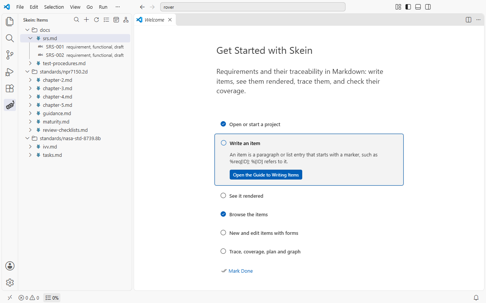
</picture>

## Where to find it

| To | Use |
| --- | --- |
| See the items | the Skein icon in the activity bar: the **Items** view |
| Make an item | **New Item** (`+`) on the Items view's title bar; **New Item in This Document...** on the **Skein** menu of a Markdown editor's title bar, and on its context menu |
| Change an item | **Edit Item...** on the editor's context menu, an item's menu in the Items view, or the **Skein** menu |
| Trace an item | **Trace** above the item (a code lens), the editor's context menu, an item in the Items view, or the **Skein** menu |
| Go to an item by ID | **Go to Item...** (the magnifier) on the Items view's title bar, or the **Skein** menu |
| Coverage, plan, graph | the buttons of the Items view's title bar, or the **Skein** menu |
| See a document rendered | VS Code's **Open Preview to the Side** on a Markdown editor |
| Every command | the coverage in the status bar opens a list of them; or type `Skein` in the Command Palette |

## The Items view

The Skein icon in the activity bar opens the **Items** view: every item of the project, by source and file, with its type, category and status, and its parts under it. Choosing an item opens it at its marker. The buttons on the view's title bar are **Go to Item**, **New Item**, **Refresh**, **Show Coverage**, **Show Plan** and **Show Graph**; an item's context menu has **Trace**, **Copy ID**, **Edit Item** and **Go to Item**. Above each item in the editor, a code lens lists its links (here, `verifies from TST-001`) and offers **Trace**.

<picture>
  <source media="(prefers-color-scheme: dark)" srcset="img/vscode/items-dark.png">
  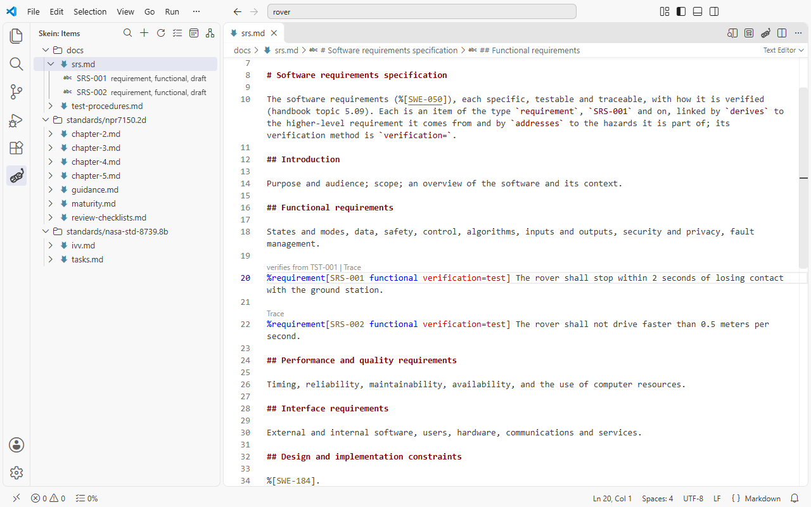
</picture>

A Markdown editor of a project has a **Skein** menu on its title bar, the Skein icon beside VS Code's own buttons:

<picture>
  <source media="(prefers-color-scheme: dark)" srcset="img/vscode/editor-menu-dark.png">
  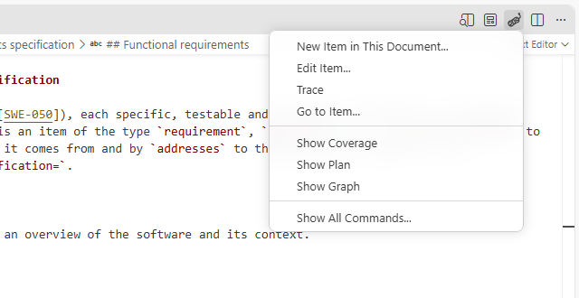
</picture>

## Writing items

Items are written in Markdown, as [writing items](writing-items.md) describes. As you type a marker, the editor completes the item types, the IDs, the categories and statuses of the type, its attributes and the link types it may have, and the items a link may point to:

<picture>
  <source media="(prefers-color-scheme: dark)" srcset="img/vscode/completion-dark.png">
  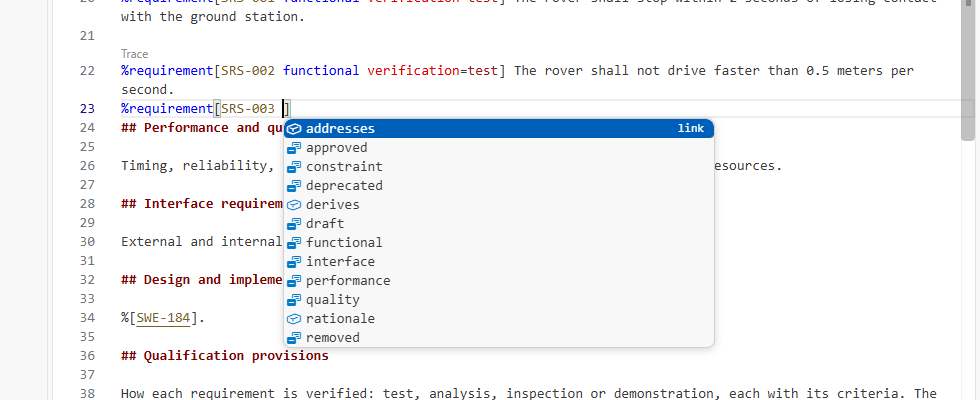
</picture>

Hovering over an ID shows the item; **Go to Definition** (`F12`) leads to it, **Find All References** (`Shift+F12`) lists every place that names it, and **Rename Symbol** (`F2`) gives it another ID everywhere, as `skein move` does.

<picture>
  <source media="(prefers-color-scheme: dark)" srcset="img/vscode/hover-dark.png">
  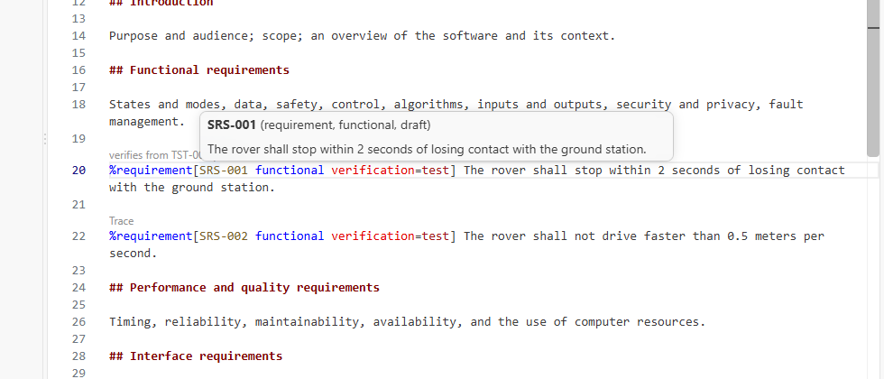
</picture>

When a file is saved, the Problems panel shows what `skein check` reports, on its line, with a quick fix (`Ctrl+.`) where Skein knows what was meant:

<picture>
  <source media="(prefers-color-scheme: dark)" srcset="img/vscode/problems-dark.png">
  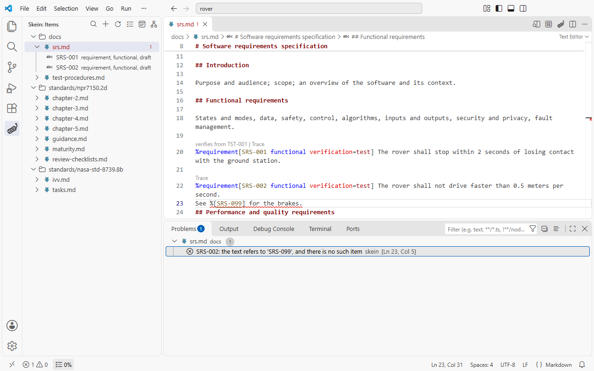
</picture>

## The preview

VS Code's Markdown preview (**Open Preview to the Side**, the button at the top right of a Markdown editor) shows a saved document as `skein render` writes it: each item with its ID, category and status, references as links to the items, a reference to an item there is not marked, and generated pages (lists, matrices, coverage, Gantt charts) in place. While a document has changes not saved, the preview shows it as written.

<picture>
  <source media="(prefers-color-scheme: dark)" srcset="img/vscode/preview-dark.png">
  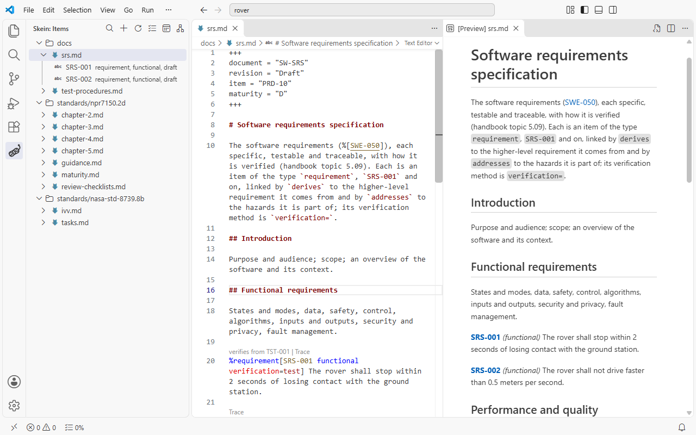
</picture>

## Forms

**New Item...** opens a form of an item type's fields: its ID (empty for the next number of a numbered type), the document it goes in or its own file, its category, status, verification method, attributes and links, and its text. **New Item in This Document...** starts it in the editor's document, of the type of the items already there. **Create** writes the marker and opens the item.

<picture>
  <source media="(prefers-color-scheme: dark)" srcset="img/vscode/form-new-dark.png">
  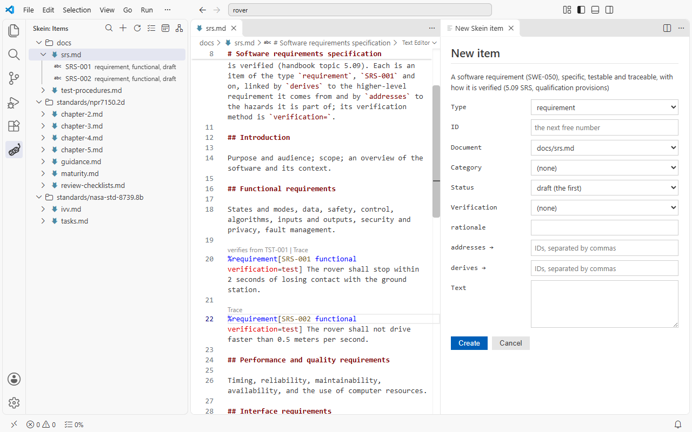
</picture>

**Edit Item...**, on an item, opens the same form with its values; **Save** writes each change into its marker or front matter.

<picture>
  <source media="(prefers-color-scheme: dark)" srcset="img/vscode/form-edit-dark.png">
  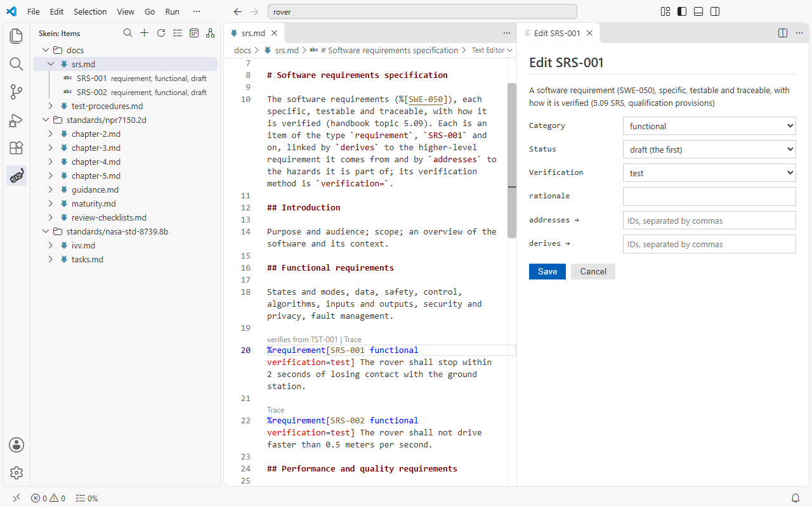
</picture>

## Trace

**Trace** opens an item's trace beside the editor: its text and attributes, its links both ways with their reviews, what cites it in code and tests, its approvals and results, and all above and below it. Its links open the items and files in the editor. It is what `skein trace` prints.

<picture>
  <source media="(prefers-color-scheme: dark)" srcset="img/vscode/trace-dark.png">
  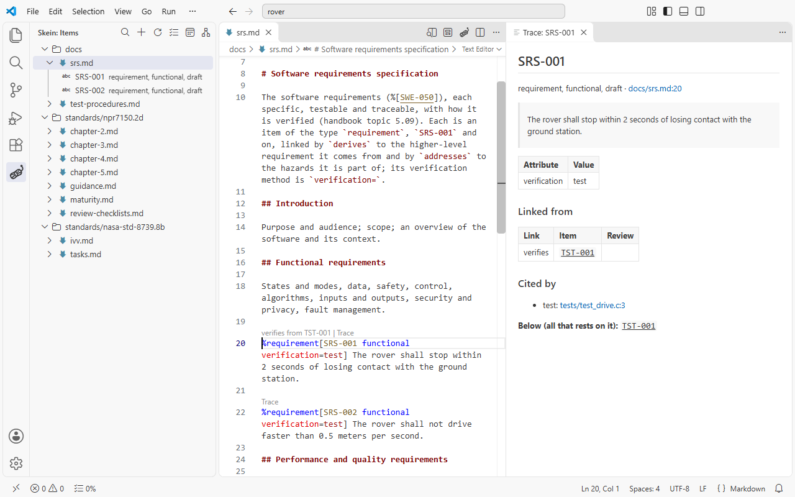
</picture>

## Coverage

**Show Coverage** opens the coverage page: for each link the project expects, how many items have it, and which do not. The share of what is covered is in the status bar, and clicking it opens a list of all of Skein's commands, **Show Coverage** first.

<picture>
  <source media="(prefers-color-scheme: dark)" srcset="img/vscode/coverage-dark.png">
  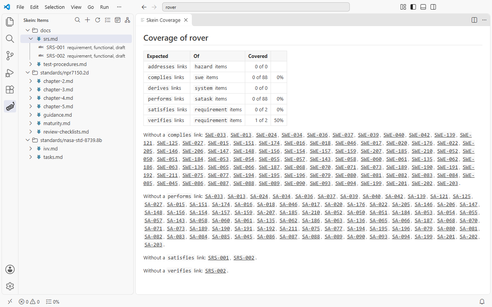
</picture>

<picture>
  <source media="(prefers-color-scheme: dark)" srcset="img/vscode/commands-dark.png">
  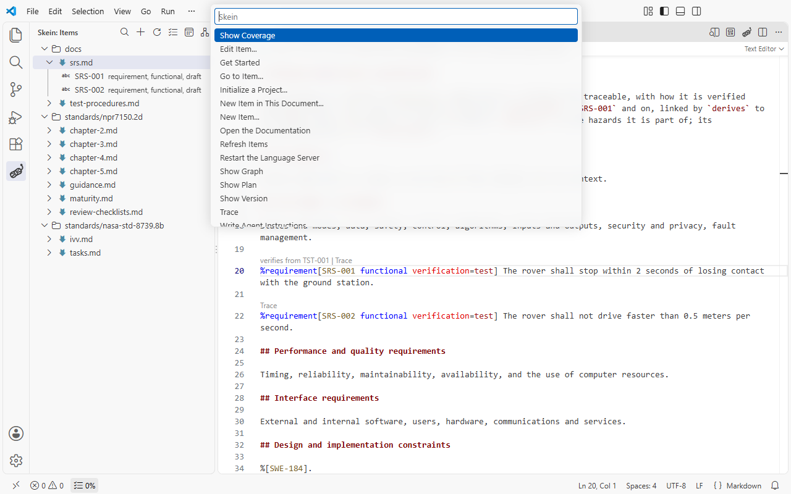
</picture>

## Graph

**Show Graph** draws the network of items and their links, each item above those that link to it, colored by type, with suspect links and links never reviewed marked. Drag to pan; zoom with the wheel, a pinch, the buttons or the keys `+`, `-`, `f` and `0`. Search, and filter by item type, link type, profile and source (here, the project's own documents). Choosing an item shows its trace beside the graph, with **Open**, **Trace**, **Copy ID**, **Review its links** and **Approve**.

<picture>
  <source media="(prefers-color-scheme: dark)" srcset="img/vscode/graph-dark.png">
  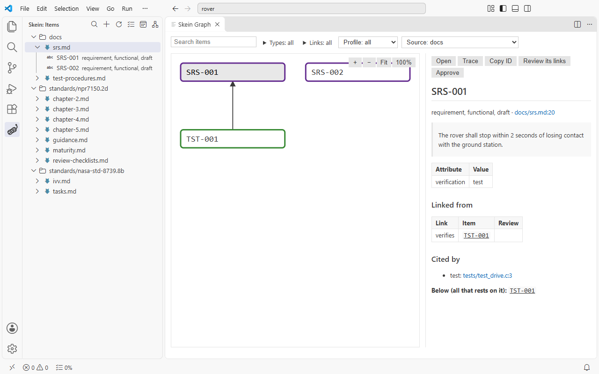
</picture>

## Plan

For a project with work items (item types with `[planning]`, as in the [planning tutorial](tutorial-planning.md)), **Show Plan** opens a Gantt chart of the schedule, with the critical path in red, and a board by status. Drag a bar to move an item, its right end to change its length, or a card to another column: the change is written into the item's marker or front matter, and the stored schedule follows.

<picture>
  <source media="(prefers-color-scheme: dark)" srcset="img/vscode/plan-dark.png">
  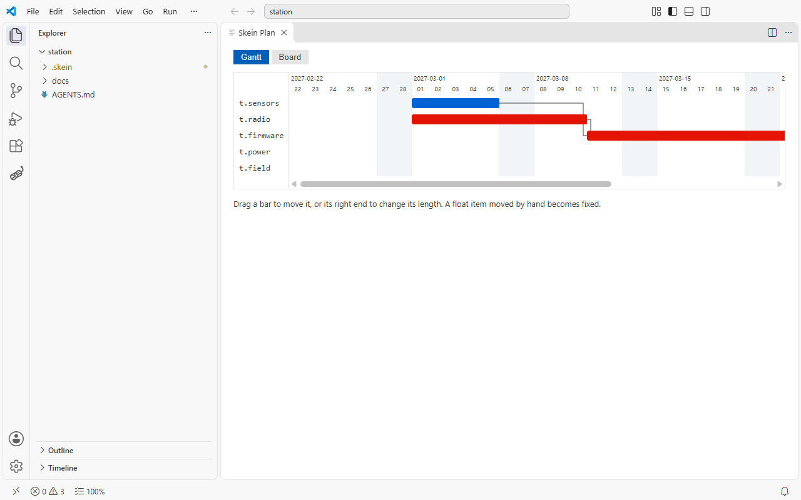
</picture>

<picture>
  <source media="(prefers-color-scheme: dark)" srcset="img/vscode/board-dark.png">
  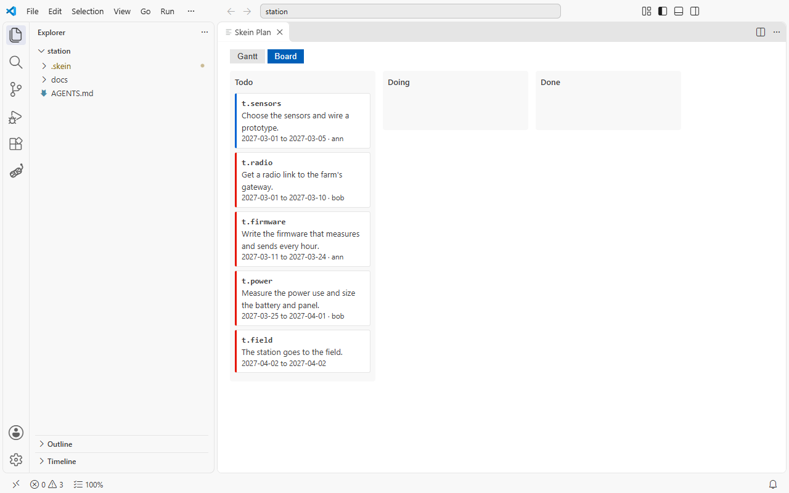
</picture>

## AI agents

VS Code's agents (Copilot's agent mode and others) get Skein's tools through `skein mcp`, which the extension offers to VS Code's MCP support: finding and tracing items, `check`, `coverage`, `impact`, and the editing commands. In chat, `#skeinItem` brings in the item under the cursor with everything linked to it. **Skein: Write Agent Instructions** writes what agents should know of the project into `AGENTS.md` (or `CLAUDE.md`).

## Commands and settings

In the Command Palette, under **Skein**: **Trace**, **Show Coverage**, **Show Plan**, **Show Graph**, **New Item...**, **New Item in This Document...**, **Edit Item...**, **Go to Item...**, **Initialize a Project...**, **Choose Project...**, **Write Agent Instructions**, **Get Started**, **Open the Documentation**, **Show All Commands...**, **Refresh Items**, **Restart the Language Server** and **Show Version**.

- `skein.path`: the full path of another `skein` to use in place of the one the extension carries. A change restarts the language server.
- `skein.codeLens.enabled`: the code lenses above items (on by default).
- `skein.statusBar.coverage`: the coverage in the status bar (on by default).
- `skein.mcp.enabled`: offer `skein mcp` to VS Code's agents (on by default).
- `skein.agents.file`, `skein.agents.skill`: where **Write Agent Instructions** writes, and whether as a skill file.
- `skein.trace.server`: log the messages to and from the language server in the output channel **Skein Language Server**.

In an untrusted workspace the language server is not started; the highlighting works either way.
