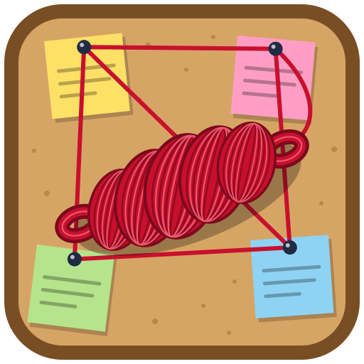

# Skein



Plain-text requirements, specifications and traceability, kept in git.

Skein holds the threads of a project together: what is needed, what is decided, what is specified, how it is built, and what proves it. Every item is a piece of Markdown in the repository with a stable ID, a type and typed links. Skein checks the whole graph, traces it in both directions, flags what a change makes suspect, imports test results, plans the work (schedules, resources, Gantt charts, burndown), and generates the views a team reads: specifications, matrices, coverage, plans and reports.

It is for projects that want the rigor of requirements management without a database or a proprietary tool: from a language specification written as atomic, numbered paragraphs (like the Ferrocene Language Specification) to a NASA-style V-model of system requirements, software requirements, design and tests.

**Status:** early, version 0.x: the file formats can still change. A project's schema, items in documents and in files of their own, citations in code and tests, reviews and approvals, test results, rendering (a static site, standalone documents, or Markdown for a site generator), templates for common standards, planning (schedules, resources, Gantt charts, boards, burndown), the GitHub and GitLab adapters, the language server, the VS Code extension and the MCP server for coding agents all work; `docs/design.md` describes them and what is still to come.

## Installing

Each [release](https://github.com/chasingdaylight/skein/releases) has `skein` as one program for Linux, macOS and Windows (x86_64 and arm64), with a `SHA256SUMS` file. Unpack the archive for your platform and put `bin/skein` on your `PATH`; it needs nothing else. On macOS there is also an installer package, `skein-v<version>-macos.pkg`, one for Apple Silicon and Intel: open it, and it installs `skein` into `/usr/local/bin` and the license into `/usr/local/share/doc/skein`. To remove it, delete those and forget the package (`sudo pkgutil --forget com.github.chasingdaylight.skein`).

Releases from 0.1.2 on are signed: `skein.exe` with an Authenticode signature, and `skein` on macOS, in the archives and the installer package, with a Developer ID and notarized by Apple; the programs in the VS Code extension are the same signed ones. A browser still marks what it downloads as coming from the internet. On macOS, double-clicking the unpacked `skein` in Finder then shows a warning, as it does for any command-line program marked that way: run it from a terminal instead, or use the installer package. Unpack the archive with `tar -xzf` in a terminal (Finder's Archive Utility passes the mark on to what it unpacks); if a mark is on `skein` already, remove it with `xattr -d com.apple.quarantine skein`. On Windows, SmartScreen may still ask about a program it has not seen often: unblock the zip before unpacking it (`Unblock-File`, or "Unblock" in its Properties).

For VS Code and editors built on it, the extension [Skein](editors/vscode/readme.md) (`chasingdaylight.skein`, on the Visual Studio Marketplace and Open VSX) highlights markers and references in Markdown and carries the `skein` program for its platform, on the `PATH` of its terminals.

## Trying it

Or build with Zig 0.17.1 (`zig build`; the binary is `zig-out/bin/skein`). Then in one of the examples:

```text
cd examples/requirements
skein check
skein trace SYS-001
skein coverage
```

| Read | For |
| --- | --- |
| [`docs/tutorial-existing-code.md`](docs/tutorial-existing-code.md) | A tutorial: Skein added to a program that exists, its requirements cited by its code and tests. |
| [`docs/tutorial-planning.md`](docs/tutorial-planning.md) | A tutorial: a project planned before its code, from needs to a schedule. |
| [`examples/`](examples/) | Two small projects to copy from: a specification as a document, and requirements as files. |
| [`docs/writing-items.md`](docs/writing-items.md) | How items, references and citations are written. |
| [`docs/project-files.md`](docs/project-files.md) | The files in `.skein/`: item types, link types, profiles. |
| [`docs/commands.md`](docs/commands.md) | The commands. |
| [`docs/reviewing.md`](docs/reviewing.md) | Fingerprints, suspect links, approvals. |
| [`docs/repositories.md`](docs/repositories.md) | Referring to the items of other repositories. |
| [`docs/results.md`](docs/results.md) | Test results. |
| [`docs/forge.md`](docs/forge.md) | Issues and pull requests on the forge. |
| [`docs/templates.md`](docs/templates.md) | Templates built into Skein. |
| [`docs/importing.md`](docs/importing.md) | Coming from Doorstop, or from a spreadsheet. |
| [`docs/requirements/`](docs/requirements/readme.md) | What Skein is required to do, in its own format, traced to its tests. |
| [`docs/design.md`](docs/design.md) | What Skein is to be. |

## Principles

- **Plain text in git is the source of truth.** Reviewable in pull requests, versioned with the code, readable by people and agents.
- **Forge-neutral.** Works with nothing but a git repository; GitHub, GitLab and Forgejo integrations are adapters on top.
- **Schema-driven.** Each project declares its item types, links and rules; Skein enforces them.
- **Prose-friendly.** An item can be its own file or a paragraph inside a document, so specifications read as documents.
- **One binary, one codebase.** Written in Zig, with no runtime dependencies and nothing fetched at build time, so it can be used where outside dependencies need approval.

## License

MIT, see `LICENSE`.
